# 面向财经股吧短文本的情感分析系统设计与实现

> **本文件为初稿底稿，不是定稿。** 按学校通知（教务通知字〔2026〕57 号），论文须经 2 次 AIGC 检测与 1 次 AI 智评，AI 代写将取消答辩资格并延后六个月重新申请。请勿直接提交：须逐段改写为自己的表述、核对每一处数字与引用，并按学校格式模板重排。
>
> **当前完成度**：正文 8 章与摘要已成稿，32 张数据表已按实验文件填好实数，14 张图中 13 张已由 `tools/make_figures.py` 生成并插入正文；仅图 7-3 系统界面截图需作者本人截取。封面信息与致谢待补。

---

## 摘要

股吧是散户投资者表达观点的主要场所，其帖子标题短小、口语化、含大量行业黑话与反讽，给情感分析带来特殊困难。本文以东方财富股吧标题为研究对象，构建了 10646 条人工标注的三分类情感数据集（训练集 8516 条、测试集 2130 条），在统一实验设置下对比了 TF-IDF 加逻辑回归与 BERT 微调两条技术路线，并在此基础上对模型错误的构成做了系统分解。

实验表明，BERT 微调在三分类任务上取得 0.7540 的准确率与 0.7491 的宏 F1，较 TF-IDF 基线的 0.6296 与 0.6204 分别高出 12.44 与 12.87 个百分点。然而逐类分析显示，中性类的 F1 达到 0.7874，是三分类中最高的，同时也是错误的主要流入方向。对 524 个测试错误的分解表明，其中 385 个（73.47%）牵涉中性边界，正负极性直接互错仅 139 个（26.53%），前者为后者的 2.8 倍。

针对这一矛盾，本文提出"中性是复合标签"的假设，并从问句统计关联、错误流向分解、句式切分评测、剔除问句重训四个角度给出量化证据：中性类样本中 48.28% 为问句，全部问句中 68.39% 被标为中性；剔除问句重训后准确率与宏 F1 反而分别下降 0.0103 与 0.0086，说明问句并非噪声。在此基础上，本文尝试级联路由、多任务与四分类重构、概率堆叠、超参扫描、阈值校准、多种子集成六类改进，均未取得统计显著且可复现的提升，从反面支持"瓶颈在标签体系而非模型容量"的判断。

最后，本文将上述模型封装为可运行的原型系统，实现数据采集、情感标注、可视化看板与情感—收益关联分析四项功能，覆盖 13 只股票、72235 条日线与 6420 条新闻。

**关键词**：情感分析；股吧文本；BERT；标签质量；类别不均衡

---

## Abstract

Stock message boards are a major venue for retail investors to express opinions. Their post titles are extremely short, colloquial, and rich in jargon and irony, which makes sentiment analysis notably harder than on standard review corpora. This thesis takes titles from the East Money stock forum (Guba) as its object of study, builds a manually annotated three-class sentiment dataset of 10,646 titles (8,516 for training, 2,130 for testing), and compares two technical routes under a unified experimental setting: TF-IDF with logistic regression, and fine-tuned BERT. On this basis it decomposes the composition of model errors systematically.

Fine-tuned BERT reaches an accuracy of 0.7540 and a macro F1 of 0.7491 on the three-class task, exceeding the TF-IDF baseline of 0.6296 and 0.6204 by 12.44 and 12.87 percentage points respectively. Per-class analysis, however, shows that the neutral class attains the highest F1 (0.7874) while simultaneously acting as the main sink of errors. Of the 524 test errors, 385 (73.47%) involve the neutral boundary, whereas direct polarity confusions account for only 139 (26.53%) — 2.8 times fewer.

To explain this contradiction, the thesis proposes the hypothesis that "neutral" is a composite label and supports it with four independent lines of quantitative evidence. First, 48.28% of neutral samples are questions, and 68.39% of all questions are labelled neutral. Second, error flow decomposition shows 73.47% of errors touch the neutral boundary. Third, on the question subset the model achieves higher accuracy but markedly lower macro F1, with positive-class recall falling to 0.2885. Fourth, retraining after removing all questions lowers both accuracy and macro F1 by 0.0103 and 0.0086, indicating that questions are not noise. Six families of improvement attempts — cascade routing, multi-task and four-class reformulation, probability stacking, hyperparameter search, threshold calibration, and multi-seed ensembling — yield no statistically significant or reproducible gain, which supports the conclusion that the bottleneck lies in the label taxonomy rather than in model capacity.

Finally, the model is encapsulated into a working prototype system providing data collection, sentiment annotation, a visual dashboard, and sentiment-return association analysis, covering 13 stocks, 72,235 daily bars, and 6,420 news items.

**Keywords**: sentiment analysis; stock message board; BERT; label quality; class imbalance

---

## 第 1 章 绪论

### 1.1 研究背景

中国资本市场的投资者结构中，个人投资者长期占据较高比例。与机构投资者依赖研报、公告等正式文本不同，散户的信息获取与观点表达大量发生在网络社区。东方财富股吧是国内访问量最大的股票论坛之一，其帖子标题构成了一个高时效、低成本的情绪观测窗口。若能把标题中的态度倾向稳定地识别出来，就可以构造日频乃至更高频的情绪指标，用于观察市场情绪的演化。

但这类文本的分析难度显著高于常见的商品评论或新闻语料。本文所用数据集的统计显示，训练集标题的平均长度为 20.6 个字符，中位数为 18 个字符，95 分位为 40 个字符，最长为 79 个字符（表 3-2）。在如此短的篇幅内，作者往往只用一个短语表达态度，缺乏完整的语法结构，指代与省略大量存在。与此同时，股吧语言有强烈的社区属性："割肉""满仓""戴帽""站岗"等词汇的极性依赖语境，反问与反讽句在字面极性上与实际态度相反，同一句式在不同行情下可能表达完全不同的情绪。

这些特点使得在通用语料上表现良好的方法在股吧文本上出现明显衰减。如何在标注资源有限、文本极短、语言高度口语化的条件下获得可用的情感分类能力，是本文要回答的第一个问题。

### 1.2 国内外研究现状

文本情感分析的方法演进大致可以分为三个阶段。早期以情感词典与规则为主，依靠人工构造的极性词表与否定、程度副词等组合规则判定倾向，赵妍妍等[1]与陆文星等[2]对此有系统梳理。这一路线可解释性强，但覆盖率受词表限制，且难以处理词序与语境。第二阶段以传统机器学习为主，将文本表示为词袋或 TF-IDF 向量[3][4]，再交由支持向量机[5][6]或逻辑回归等判别模型分类。这类方法训练成本低、在小规模标注数据上仍有竞争力，本文将其作为对照基线。第三阶段以深度学习的表示学习为主，通过预训练语言模型获得上下文相关的文本表示[7][8]，在多个公开基准上大幅超越前两代方法。Saif 等[9]在 Twitter 语料上的工作进一步说明，短文本的情感倾向高度依赖上下文语义，单纯依赖词级极性难以奏效。

金融领域的专门研究揭示了通用资源的局限。Loughran 与 McDonald[11]对 10-K 年报的分析发现，在通用词典中被判为负面的词有近四分之三在金融语境下并不表达负面含义；Malo 等[12]构建的 Financial PhraseBank 进一步说明，金融句子的语义倾向不能由词级极性简单累加得到。这一发现直接推动了领域自适应预训练模型的出现：Araci[13]与 Yang 等[14]分别在金融语料上继续预训练，得到的 FinBERT 在金融情感任务上优于通用 BERT。中文方面，祝清麟等[15]将金融情感词典与注意力机制结合，李大宇等[16]提出了大规模中文金融情感数据集的自动构建方法，Zhang 与 Yang[17]、Zhao 等[18]则把混合专家与领域适配技术引入中文金融大模型。在评测层面，Chen 等[10]在 SemEval-2017 任务 5 上给出的细粒度金融情感基准，成为后续工作常用的比较对象。

股吧与投资者情绪的关系是另一条研究线索。Antweiler 与 Frank[19]对 150 万条股票留言板帖文的分析表明，帖文情绪与同期收益存在统计关联，但预测能力有限。国内研究中，段江娇等[20]对中国股票网络论坛的信息含量做了系统检验，王娜等[21]基于东方财富股吧帖文构建了投资者情绪指数，尹海员等[22][23]分别用 Bi-LSTM 与深度学习方法挖掘股吧情绪对股价泡沫与崩盘风险的影响。技术路线上，Luan 等[24]在 24 只 A 股上做了人工标注与预测实验，李梦等[25]将 BERT 舆情分析与特征融合用于个股走势预测，Lou[34]则在东方财富股吧标题上微调 BERT 并结合 Alpha191 因子做回测。这些工作的共同特点是或侧重金融计量、或侧重交易策略回测，均未把标注体系本身作为分析对象。

评价方法方面，Sokolova 与 Lapalme[26]系统分析了分类任务的各类性能度量，Opitz 与 Burst[27]指出宏 F1 存在两套不同算法且可能改变方法排名，He 与 Garcia[28]、Buda 等[29]讨论了类别不均衡对学习的影响，Chawla 等[30]提出的 SMOTE 是常用的重采样手段。标注质量方面，Cohen[31]提出的 Kappa 系数、Landis 与 Koch[32]给出的强度划分、Artstein 与 Poesio[33]对编码者一致性的讨论，构成了检验标注可信度的基本工具。

### 1.3 现有研究的不足

综合上述工作，可以归纳出四点不足。

第一，数据来源高度集中。中文金融情感分析的研究对象以财经新闻、研报与公告为主，股吧这类口语化短文本的公开标注数据相对稀少，导致针对该场景的方法检验不足。

第二，评价指标以准确率为主。在类别不均衡的数据上，准确率会掩盖少数类被牺牲的事实。本文第 5 章将给出一个具体例子：在问句子集上，模型的准确率反而高于陈述句子集，但宏 F1 明显更低，少数类的召回率被压到 0.2885。

第三，普遍把标注数据当作真值。多数工作默认标签是准确的，把模型误差全部归因于模型能力，很少检验标签语义本身是否存在复合性缺陷。

第四，缺少区分性的对照设计。要判断误差来自模型容量还是标签质量，需要专门设计能把两者分开的实验，而现有工作很少这样做。

经检索，未见专门讨论"中性/无态度/提问"三类语义在同一标签下混淆的可核验文献。这一空白是本文的切入点。

### 1.4 研究内容与论文结构

本文的工作包含四部分：数据质量核查、双路线三任务对比、中性类瓶颈的量化分析与改进尝试、原型系统实现。四部分的先后关系与各自的产出如图 1-1 所示。

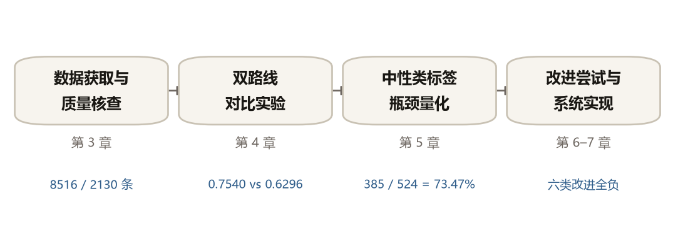

全文共八章。第 1 章交代背景与现状；第 2 章介绍后文用到的理论与指标；第 3 章说明数据来源并做质量核查；第 4 章给出模型对比的主结果；第 5 章分解中性类瓶颈；第 6 章报告六类改进尝试及其负结论；第 7 章描述系统实现；第 8 章总结并说明不足。

---

## 第 2 章 相关理论与技术基础

### 2.1 文本情感分析的任务定义

本文处理的是三分类情感分析任务：给定一条股吧标题，判定其表达的态度属于负面、正面还是中性。形式化地，记输入文本为 $x$，标签集合为 $Y=\{\text{负面}, \text{正面}, \text{中性}\}$，任务是学习映射 $f: X \rightarrow Y$。

三类标签的操作性定义如下。负面指文本表达对标的的看空、失望、抱怨或风险提示；正面指表达看多、认可、乐观或收益预期；中性指不含明确褒贬倾向。

需要指出的是，上述定义中的"中性"是一个否定式定义——它描述的是"没有什么"，而不是"有什么"。在商品评论场景下，这一界定通常不会引起歧义，因为不含褒贬的评论数量有限。但在股吧语境下，"没有态度"的文本可能出于完全不同的原因：可能是真的在客观陈述事实，也可能只是提出了一个问题而尚未表达立场。这两类文本在语言学上并不相同，却被同一个标签收拢。本章暂按上述定义展开，第 5 章将回到这个问题。

### 2.2 TF-IDF 与线性分类器

TF-IDF 是信息检索领域的经典文本表示方法，其思想由 Sparck Jones[3]提出，后经 Salton 与 Buckley[4]系统化。对词项 $t$ 与文档 $d$，词频 $\mathrm{tf}(t,d)$ 反映该词在文档内的出现强度，逆文档频率 $\mathrm{idf}(t)=\log(N/\mathrm{df}(t))$ 反映该词在整个语料中的区分能力，两者相乘得到权重。这一设计的直觉是：在几乎所有文档中都出现的词（如"的""了"）不携带区分信息，应予压低；只在少数文档中出现的词则更能标识文档主题。

得到向量表示后，本文采用逻辑回归作为判别器。对 $K$ 类问题，模型为每类学习一组权重 $w_k$ 与偏置 $b_k$，通过 softmax 函数将线性得分转化为概率，训练目标是最小化交叉熵损失。选择逻辑回归而非支持向量机[5][6]的原因是：前者直接输出概率，便于第 6 章的概率堆叠实验；同时 scikit-learn[35]的实现成熟，训练在秒级完成。本文实测 TF-IDF 加逻辑回归在三分类任务上的单次训练耗时为 3.3 秒，这一成本优势是它作为基线的第二个理由。

需要说明的是，词袋表示丢弃了词序信息，对"不看好"与"看好"这类仅差一个否定词的文本，只能依靠否定词本身作为特征来区分。这是该路线的固有局限，也是第 4 章中它与 BERT 差距的主要来源之一。

### 2.3 BERT 与中文预训练模型

BERT 由 Devlin 等[7]提出，其核心是 Transformer 编码器堆叠与双向上下文建模。与之前的单向语言模型不同，BERT 在预训练阶段采用掩码语言建模任务：随机遮蔽输入中的部分词元，要求模型根据左右两侧的上下文还原被遮蔽的词元。这一训练目标迫使模型学习双向的上下文表示，而不仅是单向的条件概率。

预训练完成后，BERT 通过微调适配下游任务。具体做法是在编码器输出之上加一个线性分类头，取特殊词元 `[CLS]` 位置的表示作为整句表示，用下游标注数据以较小的学习率对全部参数做端到端训练。本文使用 transformers 库[36]加载 `bert-base-chinese` 权重，该模型采用中文原生词表，权重公开且可离线加载，适合在单机环境下复现。需要说明的是，本文以会议版[7]为准，其预印本[37]在部分实验细节上略有差异。此外，该权重未采用全词掩码策略，Cui 等[8]提出的全词掩码版本在中文任务上通常更优，本文未做替换，是为了保持与已有工作的可比性。

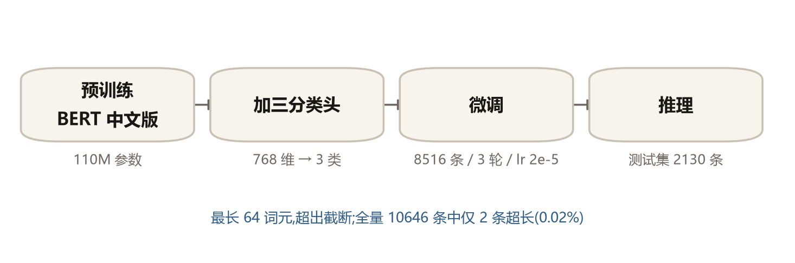

微调范式的代价是计算成本。本文实测 BERT 单次训练耗时 109.3 至 146.0 秒，是 TF-IDF 的 10 至 42 倍，显存峰值约 2.03 GB（表 4-6）。这一成本差异决定了它在实际系统中不能像 TF-IDF 那样随意重训，第 7 章的模型加载策略对此做了相应设计。

### 2.4 评价指标

设测试集共 $N$ 条样本，对类别 $c$，记 $TP_c$ 为真阳性数、$FP_c$ 为假阳性数、$FN_c$ 为假阴性数，则精确率 $P_c = TP_c/(TP_c+FP_c)$，召回率 $R_c = TP_c/(TP_c+FN_c)$，$F1_c$ 为两者的调和平均。准确率为全部正确预测数除以 $N$。

多分类场景下需要把逐类指标汇总为单一数值。微平均先汇总各类的 $TP$、$FP$、$FN$ 再统一计算，结果受样本量大的类别主导；宏平均先计算各类指标再取算术平均，对每类等权。在类别不均衡的数据上，两者可能给出不同结论：微平均（近似准确率）会掩盖少数类的糟糕表现，宏平均则会把少数类的问题放大。本文以宏 F1 作为主指标，理由在第 5 章 5.4 节有实证说明。

宏 F1 本身还有一处容易被忽略的歧义，Opitz 与 Burst[27]对此做了专门讨论。口径一是先算每类 F1 再取算术平均，即 scikit-learn 中 `average='macro'` 的行为；口径二是先分别对精确率与召回率取宏平均，再由宏精确率与宏召回率求调和平均。文献指出两者在极端不均衡数据上的差异可达 0.5，足以改变方法排名。

本文明确采用口径一，并在第 6 章表 6-1 中实测了两套口径在本文数据上的差异，最大值为 0.0073。差异远小于文献报告的原因在于，本文数据集的类别比为 1.49，不属于极端不均衡。这里需要强调一个引用纪律：文献中的数值结论都附带数据条件，脱离条件直接引用会得出错误判断。

混淆矩阵用于展示错误的流向。以真实类别为行、预测类别为列，对角线元素为正确预测数，非对角线元素为各类错误的具体去向。相比单一的准确率，混淆矩阵能回答"错误从哪里来、往哪里去"，这一信息在第 5 章的分析中是主要依据。

### 2.5 本章小结

本章定义了情感分析任务与三类标签，介绍了 TF-IDF 与 BERT 两条技术路线，并说明了评价指标的选择依据与宏 F1 的口径歧义。下一章转入数据。

---

## 第 3 章 数据获取与质量核查

### 3.1 数据来源与标注体系

本文使用的数据为东方财富股吧的帖子标题，由人工标注为三类情感。标题字段保留原始发布形态，未做分词或清洗，仅去除首尾空白。标注遵循第 2.1 节给出的操作性定义，标签编码为 0 表示负面、1 表示正面、2 表示中性。

数据集按 8:2 划分为训练集与测试集，训练集 8516 条、测试集 2130 条，合计 10646 条。划分在标注完成后一次性完成并固定，后续所有实验共用同一划分，以保证不同方法之间的可比性。

选择标题而非正文作为分析对象，有三点考虑。一是标题是用户在信息流中实际看到的内容，情绪表达往往集中在标题；二是标题长度短，标注成本低，在有限人力下能获得更大的样本量；三是标题的短文本特性正是本文关注的困难所在，用正文会削弱问题的针对性。

### 3.2 数据规模与分布

表 3-1 给出两个子集的标签分布，图 3-1 是其柱状图形式。训练集负面 2529 条（29.70%）、正面 2406 条（28.25%）、中性 3581 条（42.05%）；测试集负面 641 条（30.09%）、正面 618 条（29.01%）、中性 871 条（40.89%）。

**表 3-1 数据集规模与标签分布**

| 数据集 | 负面 | 正面 | 中性 | 合计 |
|---|---|---|---|---|
| 训练集 | 2529（29.70%） | 2406（28.25%） | 3581（42.05%） | 8516 |
| 测试集 | 641（30.09%） | 618（29.01%） | 871（40.89%） | 2130 |
| 合计 | 3170（29.78%） | 3024（28.41%） | 4452（41.82%） | 10646 |

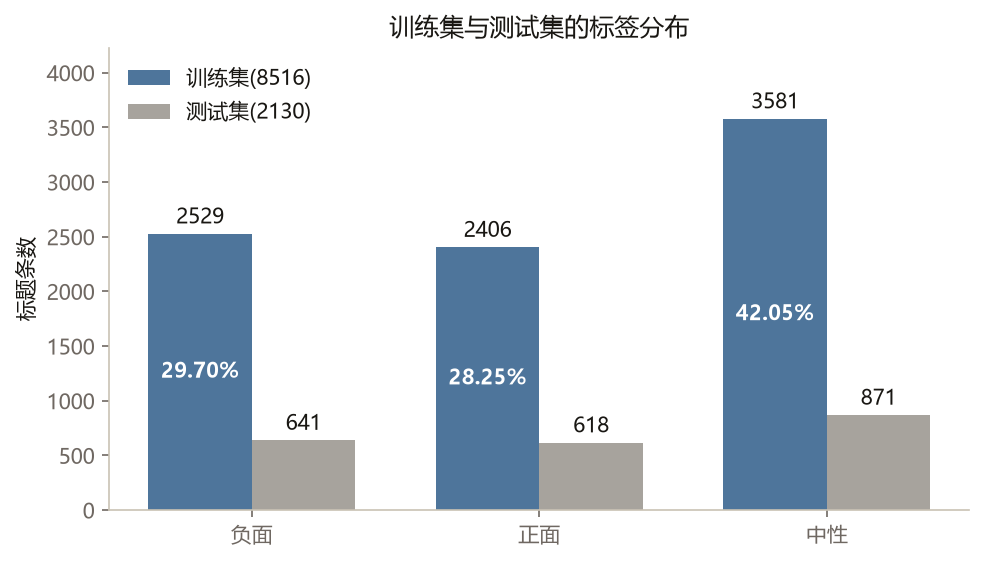

表 3-2 给出训练集标题的长度统计，图 3-2 是长度分布直方图，图中标出了 64 个词元的截断位置。

**表 3-2 文本长度统计（训练集标题）**

| 指标 | 均值 | 中位数 | 95 分位 | 最大值 |
|---|---|---|---|---|
| 字符数 | 20.6 | 18 | 40 | 79 |

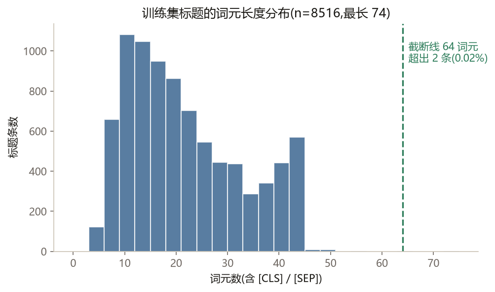

作为参照，系统在线采集的 6420 条财经新闻标题的字符数均值为 30.9、中位数为 29、90 分位为 48、最大值为 102。两类文本的长度差异本身就提示了语体差异（详见第 7 章）。

从表 3-1 可以读出两点。第一，最大类与最小类的样本量之比为 $3581/2406=1.49$，属于轻度不均衡。这一比例不足以让准确率完全失真，但足以让多数类获得系统性优势——第 4 章将看到，多数类基线的准确率已达 0.4089。第二，训练集与测试集的三类比例高度接近（29.70/28.25/42.05 对 30.09/29.01/40.89），说明两个子集来自同一分布，不存在先验偏移。这一条在后续论证中会被反复用到：它排除了"测试集分布不同导致指标下降"这一解释。

### 3.3 数据质量核查

在进入模型实验之前，本文对数据做了三项核查，目的是排除"后续结论由脏数据造成"这一可能。三项核查的结果汇总于表 3-3。

**表 3-3 数据质量核查**

| 核查项 | 结果 |
|---|---|
| 训练集内完全重复标题 | 0 条 |
| 训练集与测试集交集 | 0 条 |
| 归一化后重复组 | 34 组，涉及 117 条 |
| 其中标签不一致的组 | 1 组，涉及 2 条 |
| 超过 64 token 的样本 | 2 条（0.02%） |
| 最近邻余弦相似度（中位数 / 均值） | 0.2692 / 0.3094 |

第一项是完全重复检查。训练集内部标题完全重复的记录为 0 条，训练集与测试集的交集为 0 条。这说明数据划分没有发生泄漏，测试集上的指标可以反映真实的泛化能力。

第二项是近重复与标签冲突检查。将标题去除标点、空白与数字后归并，得到 34 组近重复、涉及 117 条记录。逐组检查标签后发现，标签不一致的只有 1 组、共 2 条（"冲高回落"分别被标为负面与中性）。按记录数计，标签冲突率约为 1.7%。这一结果说明标注质量较高，个别冲突不足以解释系统性的分类误差。作为补充，本文计算了样本间的最近邻余弦相似度，中位数为 0.2692、均值为 0.3094，说明语料内部并不存在大量语义雷同的样本。

第三项是截断风险检查。BERT 的输入长度上限设为 64 个词元，而原始文本最长为 79 个字符。字符数与词元数并不等价，因此本文用实际词表对全部 10646 条标题做了分词，统计超过 64 个词元的样本数。结果为 2 条，占 0.02%，最长样本为 74 个词元。这说明截断影响的样本极少，不构成系统性问题。

这三项核查的意义在第 5 章才会完全显现。届时本文将论证"中性类难学是因为标签语义复合"，而这一论断成立的前提是数据本身干净。若数据中存在大量重复、泄漏或标签噪声，同样的现象完全可以由数据缺陷解释。因此本节不是例行公事，而是后续论证的地基。

### 3.4 本章小结

本章说明了数据来源、划分方式与标签体系，并通过完全重复、近重复与标签冲突、截断风险三项核查确认数据质量足以支撑后续分析。数据集类别比为 1.49，属于轻度不均衡；训练集与测试集先验一致，不存在分布偏移。

---

## 第 4 章 情感分析模型的设计与对比实验

### 4.1 实验设置

实验在单机环境下完成，显卡为 RTX 5060（8 GB 显存），CUDA 版本 13.0。BERT 微调的超参数固定为：最大输入长度 64、批大小 32、训练轮数 3、学习率 $2\times10^{-5}$、预训练权重 `bert-base-chinese`（附录 A）。随机种子固定为 42，数据划分沿用第 3 章的固定划分。TF-IDF 基线使用 scikit-learn 的 `TfidfVectorizer` 与 `LogisticRegression`。

为定位模型的困难所在，本文在原始三分类任务之外构造了两个派生任务，构成三个任务的对照（表 4-1）。任务 A 为原始三分类，标签为负面、正面、中性。任务 B 剔除全部中性样本，只在 4935 条训练样本与 1259 条测试样本上做负面与正面的二分类，考察纯粹的极性判断能力。任务 C 把标签合并为"中性"与"有情感"两类，考察模型判断"是否存在态度"的能力。

设计 B 与 C 的动机是：三分类任务的误差可以来自两个性质不同的来源——分不清看涨还是看跌，或者分不清有没有态度。把任务拆开，就能分别测量这两个来源的难度。这一设计是第 5 章分析的直接引子。

### 4.2 对比结果

表 4-1 汇总了三个任务上两条路线的表现，并给出多数类基线作为参照。图 4-1 是同一结果的分组柱状图。

**表 4-1 三任务对比总表**

| 任务 | 类别数 | 训练/测试 | TF-IDF 准确率 | TF-IDF 宏 F1 | BERT 准确率 | BERT 宏 F1 | 多数类基线 |
|---|---|---|---|---|---|---|---|
| A 三分类 | 3 | 8516 / 2130 | 0.6296 | 0.6204 | **0.7540** | **0.7491** | 0.4089 |
| B 二分类极性 | 2 | 4935 / 1259 | 0.7546 | 0.7540 | **0.8435** | **0.8435** | 0.5091 |
| C 中性 vs 有情感 | 2 | 8516 / 2130 | 0.7352 | 0.7093 | **0.8099** | **0.7962** | 0.5911 |

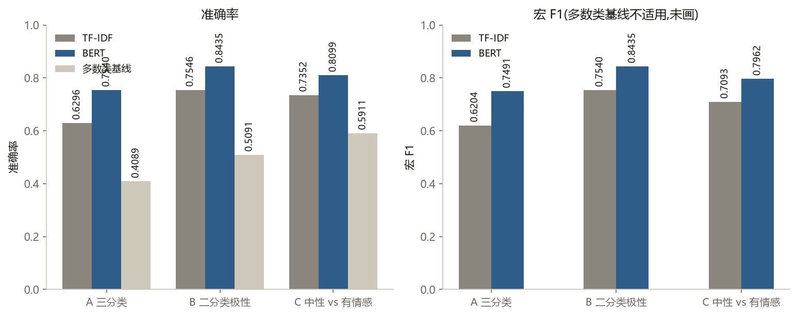

任务 A 上，TF-IDF 的准确率为 0.6296、宏 F1 为 0.6204；BERT 的准确率为 0.7540、宏 F1 为 0.7491，分别高出 12.44 与 12.87 个百分点。任务 B 上，TF-IDF 为 0.7546/0.7540，BERT 为 0.8435/0.8435，差距为 8.89 与 8.95 个百分点。任务 C 上，TF-IDF 为 0.7352/0.7093，BERT 为 0.8099/0.7962，差距为 7.47 与 8.69 个百分点。

三点观察。第一，三个任务上 BERT 都明显优于 TF-IDF，说明上下文相关的表示对短文本情感判断确实有效，这与文献中的普遍结论一致。第二，三个任务上两条路线都远高于多数类基线（0.4089、0.5091、0.5911），说明模型学到了有效信号，不是靠猜多数类过关。第三，任务 B 的成绩最高、任务 C 次之、任务 A 最低，这个排序本身就说明问题：当任务只需要判断极性或只需要判断有无态度时，模型表现更好；一旦要求同时做这两件事，成绩就下降。这暗示两类判断之间存在干扰。

训练成本方面见表 4-6。BERT 单次训练耗时 109.3 至 146.0 秒，是 TF-IDF 的 10 至 42 倍；显存峰值约 2.03 GB。

**表 4-6 训练成本对比**

| 任务 | TF-IDF 耗时（秒） | BERT 耗时（秒） | 倍数 |
|---|---|---|---|
| A 三分类 | 3.3 | 139.4 | 42× |
| B 二分类极性 | 10.9 | 109.3 | 10× |
| C 中性 vs 有情感 | 4.7 | 146.0 | 31× |

需要说明的是，表 4-6 中任务 B 的 TF-IDF 耗时为 10.9 秒，高于任务 A 的 3.3 秒，而任务 B 的样本量（4935）反而少于任务 A（8516）。这一反常来自单次运行的进程启动与预热开销，不反映算法的真实复杂度，因此该列数值只作量级参考，不适合做任务间的横向比较。BERT 一列的样本量与耗时呈正相关，可作为成本量级的可靠参照。

### 4.3 分类明细与混淆矩阵

表 4-2 与表 4-3 分别给出 BERT 与 TF-IDF 在三分类任务上的逐类指标。

**表 4-2 BERT 三分类分类明细**

| 类别 | 精确率 | 召回率 | F1 | 支持数 |
|---|---|---|---|---|
| 负面 | 0.7197 | 0.6849 | 0.7019 | 641 |
| 正面 | 0.7828 | 0.7346 | 0.7579 | 618 |
| 中性 | 0.7585 | 0.8186 | 0.7874 | 871 |
| 准确率 | — | — | 0.7540 | 2130 |
| 宏平均 | 0.7536 | 0.7460 | 0.7491 | 2130 |

> 负面类的 F1 由精确率与召回率重算得 0.7019；scikit-learn 的分类报告文本因逐位四舍五入显示为 0.7018，两者差异属显示精度问题。

**表 4-3 TF-IDF 三分类分类明细**

| 类别 | 精确率 | 召回率 | F1 | 支持数 |
|---|---|---|---|---|
| 负面 | 0.5978 | 0.5195 | 0.5559 | 641 |
| 正面 | 0.6741 | 0.5890 | 0.6287 | 618 |
| 中性 | 0.6234 | 0.7394 | 0.6765 | 871 |
| 准确率 | — | — | 0.6296 | 2130 |
| 宏平均 | 0.6318 | 0.6160 | 0.6204 | 2130 |

BERT 的逐类 F1 为：负面 0.7019、正面 0.7579、中性 0.7874。中性类的 F1 最高，精确率 0.7585、召回率 0.8186，均高于另两类。TF-IDF 的逐类 F1 为负面 0.5559、正面 0.6287、中性 0.6765，排序与 BERT 一致，但每一类都明显更低。

表面上看，这是一个令人满意的结果：中性类作为样本量最大的类别，取得了最好的分类效果。但混淆矩阵给出了相反的图景。

表 4-4 是 BERT 的混淆矩阵，图 4-2 是其行归一化热力图。

**表 4-4 BERT 三分类混淆矩阵**

| 真实 \ 预测 | 负面 | 正面 | 中性 |
|---|---|---|---|
| 负面 | 439 | 81 | 121 |
| 正面 | 58 | 454 | 106 |
| 中性 | 113 | 45 | 713 |

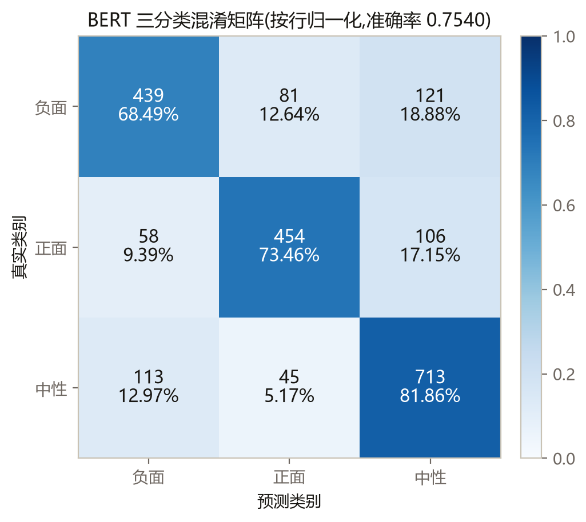

真实为负面的 641 条中有 121 条被预测为中性，真实为正面的 618 条中有 106 条被预测为中性，两者合计 227 条。与此同时，真实为中性的 871 条中有 113 条被预测为负面、45 条被预测为正面。也就是说，中性类既向两个极性类输出错误，也从两个极性类吸收错误。

这里出现了一个矛盾：中性类是三分类中 F1 最高的类，同时也是错误的主要去处。前者说明模型对中性类的整体判别能力不弱，后者说明模型在边界上倾向于把难以判断的样本归入中性。这两个事实并不冲突——它们共同指向一个可能：中性这个标签覆盖的样本本身在语义上不是同质的，其中一部分与两个极性类存在系统性重叠。第 5 章将对此做定量分解。

**表 4-5 TF-IDF 三分类混淆矩阵**

| 真实 \ 预测 | 负面 | 正面 | 中性 |
|---|---|---|---|
| 负面 | 333 | 84 | 224 |
| 正面 | 89 | 364 | 165 |
| 中性 | 135 | 92 | 644 |

TF-IDF 的混淆矩阵（表 4-5）呈现同样的方向，但程度更重：真实为负面被预测为中性的有 224 条，真实为正面被预测为中性的有 165 条，合计 389 条。这说明"向中性塌缩"不是 BERT 特有的现象，而是任务本身的属性。

### 4.4 本章小结

本章在统一的实验设置下比较了 TF-IDF 与 BERT 在三个任务上的表现。BERT 在三分类任务上取得 0.7540 的准确率与 0.7491 的宏 F1，较基线分别高出 12.44 与 12.87 个百分点，代价是 10 至 42 倍的训练时间。逐类分析显示中性类 F1 最高却吸收最多错误，这一矛盾构成了下一章的分析起点。

---

## 第 5 章 中性类标签瓶颈的量化分析

### 5.1 研究问题的提出

第 4 章留下了一个矛盾：中性类的 F1 达到 0.7874，是三分类中最高的；但混淆矩阵显示它同时是错误的主要流入方向。要解释这个矛盾，可以提出两个竞争假设。

H1（模型能力假说）：模型容量不足，无法学到区分中性与其他两类的边界。若 H1 成立，则应通过增大模型、增加训练轮数、调整超参数等方式改善，且改善应当在指标上体现。

H2（标签体系假说）：中性这个标签的语义是复合的，它把若干种在语言学上不同质的样本收拢到同一类，导致边界本身不清晰。若 H2 成立，则模型能力的提升对边界问题无效，因为问题不在模型侧。

这两个假设对后续工作方向的指引完全不同，因此必须用实验区分。本章设计四条互相独立的证据：问句与中性标签的统计关联、错误流向的分解、按句式切分测试集、剔除问句后重训。四条证据分别从标签分布、误差构成、子集表现、因果干预四个角度切入，若结论一致，则 H2 成立。

### 5.2 证据一：问句与中性标签的统计关联

如果中性标签确实收拢了异质样本，那么在标签分布上应当能找到痕迹。本文首先检验一个最直观的候选：提问句。

判据采用宽窄两个口径。窄口径只认以问号（`?` 或 `？`）结尾的标题；宽口径在此基础上，再纳入以句末疑问语气词（吗、呢、吧）结尾，或含有疑问词（什么、为什么、怎么、如何、是否、多少、哪个）的标题。给出两个口径是为了避免"挑选对自己有利的判据"这一质疑——若结论只在其中一个口径下成立，其可信度就应打折扣。

**表 3-4 训练集问句分布**

| 类别 | 样本数 | 问句数（窄口径） | 占比 | 宽口径问句数 | 宽口径占比 |
|---|---|---|---|---|---|
| 负面 | 2529 | 576 | 22.78% | 910 | 35.98% |
| 正面 | 2406 | 223 | 9.27% | 458 | 19.04% |
| 中性 | 3581 | 1729 | **48.28%** | 2345 | 65.48% |
| 合计 | 8516 | 2528 | 29.69% | 3713 | 43.60% |

表 3-4 是训练集的结果，图 5-1 对比了三类的问句占比。按窄口径，中性类 3581 条中有 1729 条为问句，占 48.28%；负面类 2529 条中为 576 条，占 22.78%；正面类 2406 条中为 223 条，占 9.27%。全体 8516 条中有 2528 条为问句，占 29.69%。按宽口径，三类占比分别为 65.48%、35.98%、19.04%，全体为 43.60%。

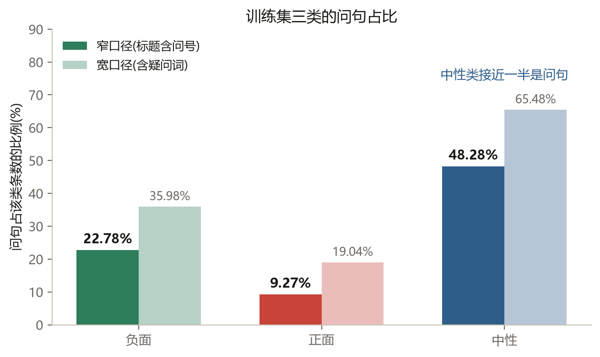

这里有两个方向相反的读法，都必须给出。第一个方向：中性类样本中有 48.28% 是问句——将近一半的中性样本带有提问特征。第二个方向：全部问句中有 $1729/2528=68.39\%$ 被标为中性。前者说明中性类的构成中含有大量问句，后者说明问句在标注时大概率被归入中性。

两类对比进一步强化了这一关联。负面类的问句占比为 22.78%，正面类仅为 9.27%，中性类是正面类的 5.2 倍。问号与中性标签的关联强度显著高于它与其他两类的关联，这是"复合标签"的一个统计指纹：如果中性只是"没有态度"的单一语义，不应出现如此强的句式偏向。

**表 3-5 测试集问句分布**

| 类别 | 样本数 | 问句数 | 占比 |
|---|---|---|---|
| 负面 | 641 | 150 | 23.40% |
| 正面 | 618 | 52 | 8.41% |
| 中性 | 871 | 407 | 46.73% |
| 合计 | 2130 | 609 | 28.59% |

测试集上呈现同样的模式（表 3-5）：中性类问句占比 46.73%，负面类 23.40%，正面类 8.41%，全体 28.59%。训练集与测试集的一致性说明这不是抽样波动。

需要强调的是，本节只建立了统计关联，尚未证明因果关系。问句与中性标签同时出现，可能是因为标注者面对提问句时倾向于选择"没有明确态度"，也可能是因为提问句本身确实多出现在中性语境中。要区分这两种解释，需要看错误结构（证据二）与干预实验（证据四）。

### 5.3 证据二：错误流向分解

BERT 在测试集上的 524 个错误，可以按两种口径归并。

口径一按预测类别归并，即"错误被哪个类吸收"。

**表 5-1 错误流向（口径一：按预测类别归并）**

| 预测类别 | 吸收的错误数 | 占全部错误 |
|---|---|---|
| 中性 | 227 | 43.32% |
| 负面 | 171 | 32.63% |
| 正面 | 126 | 24.05% |

表 5-1 显示：被预测为中性的错误 227 条，占 43.32%；被预测为负面的 171 条，占 32.63%；被预测为正面的 126 条，占 24.05%。按此口径，中性是吸收错误最多的类，但优势并不悬殊。

口径二按错误是否牵涉中性边界归并，即"这条错误的真实类或预测类中是否有一个是中性"。

**表 5-2 错误流向（口径二：按是否牵涉中性边界归并）**

| 错误类型 | 条数 | 占全部错误 |
|---|---|---|
| 牵涉中性边界 | **385** | **73.47%** |
| 负面与正面直接互错 | 139 | 26.53% |
| 合计 | 524 | 100% |

表 5-2 显示：牵涉中性边界的错误 385 条，占 73.47%；负面与正面直接互错的 139 条，占 26.53%。前者是后者的 $385/139=2.77$ 倍，约 2.8 倍。图 5-2 直观对比了这两类错误的规模。

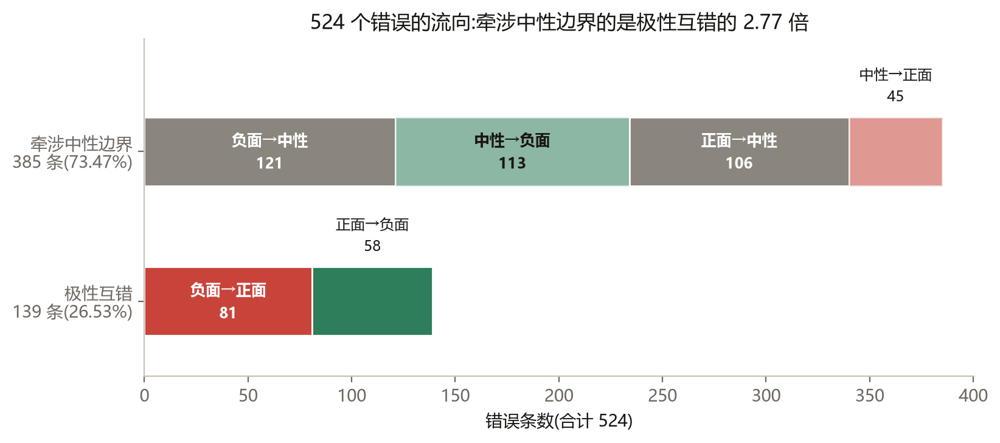

两个口径必须都报，理由如下。只报口径一会低估问题：当一条真实为负面的样本被误判为中性时，按预测类别归并，这条错误被记在"中性吸收"名下；但当一条真实为中性的样本被误判为负面时，它被记在"负面吸收"名下，中性类反而"少了一条错误"。因此口径一显示的 43.32% 是中性作为预测结果的占比，不是中性边界参与的错误占比。只报口径二又说不清错误具体流向哪里，无法指导改进。两个口径结合，才能既看到问题的规模，又看到错误的结构。

**表 5-3 具体混淆对（仅非零）**

| 真实类别 | 被预测为 | 条数 | 占全部错误 |
|---|---|---|---|
| 负面 | 中性 | 121 | 23.09% |
| 中性 | 负面 | 113 | 21.56% |
| 正面 | 中性 | 106 | 20.23% |
| 负面 | 正面 | 81 | 15.46% |
| 正面 | 负面 | 58 | 11.07% |
| 中性 | 正面 | 45 | 8.59% |

表 5-3 给出具体的混淆对。按条数排序：负面被判为中性 121 条（23.09%）、中性被判为负面 113 条（21.56%）、正面被判为中性 106 条（20.23%）、负面被判为正面 81 条（15.46%）、正面被判为负面 58 条（11.07%）、中性被判为正面 45 条（8.59%）。前三位全部牵涉中性，合计 340 条，占全部错误的 64.9%。

由此可以得出本章的第一个结论：模型的主要困难不在"看涨还是看跌"这条边界上，而在"有没有态度"这条边界上。极性互错只占错误的四分之一强，其余近四分之三都与中性有关。

### 5.4 证据三：按句式切分测试集

证据一显示了问句与中性标签的关联，证据二显示了错误集中在中性边界。若这两件事有共同原因，那么按句式切分测试集后，两个子集的表现应当呈现系统性差异。

**表 5-4 按句式切分测试集**

| 测试子集 | 样本数 | 准确率 | 宏 F1 |
|---|---|---|---|
| 全部 | 2130 | 0.7540 | 0.7491 |
| 陈述句 | 1521 | 0.7403 | 0.7379 |
| 问句 | 609 | **0.7882** | **0.6492** |

本文把测试集 2130 条按窄口径分为陈述句 1521 条与问句 609 条，分别评测（表 5-4）。结果出现了一个反直觉的现象：问句组的准确率为 0.7882，反而高于陈述句组的 0.7403，也高于全集的 0.7540；但问句组的宏 F1 为 0.6492，明显低于陈述句组的 0.7379。图 5-3 把两个指标并排画出，两条柱子的高低方向相反。

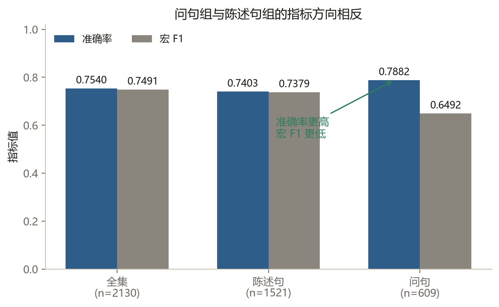

准确率与宏 F1 给出相反的方向，原因在子集的类别构成。问句组中中性占 66.83%，模型只要多预测中性就能获得较高的准确率。宏 F1 对每类等权，立刻暴露了被准确率掩盖的问题：

**表 5-5 子集内各类召回率**

| 测试子集 | 类别 | 样本数 | 召回率 |
|---|---|---|---|
| 陈述句 | 负面 | 491 | 0.6823 |
| 陈述句 | 正面 | 566 | 0.7756 |
| 陈述句 | 中性 | 464 | 0.7586 |
| 问句 | 负面 | 150 | 0.6933 |
| 问句 | 正面 | 52 | **0.2885** |
| 问句 | 中性 | 407 | 0.8870 |

表 5-5 显示，问句组的正面类召回率仅为 0.2885，而陈述句组为 0.7756；问句组的中性类召回率为 0.8870，陈述句组为 0.7586。也就是说，在问句子集上，模型几乎把所有样本都往中性推，代价是正面类的大量漏判。

这个结果有两重意义。在方法层面，它给出了"为什么本文以宏 F1 为主指标"的实证理由：只看准确率会得出"模型处理问句更好"的错误结论，而实际上模型在问句子集上牺牲了整个正面类。在论证层面，它支持 H2：如果问句只是普通的难样本，不应出现"准确率更高但少数类崩溃"这种特定形态；这种形态恰恰说明问句子集的中性比例过高，使得"多预测中性"成为局部最优策略。

### 5.5 证据四：剔除问句重训

前三条证据都是观察性的。若中性标签的复合性确实来自问句的混入，一个自然的推论是：把问句从训练集中删掉，模型应当学得更好。本文直接检验了这个推论。

**表 5-6 剔除问句重训**

| 训练集 | 训练样本 | 测试准确率 | 测试宏 F1 |
|---|---|---|---|
| 全量（基线） | 8516 | 0.7540 | 0.7491 |
| 剔除问句 | 5988 | 0.7437 | 0.7405 |
| 差值 | −2528 | **−0.0103** | **−0.0086** |

从训练集删除 2528 条问句，剩余 5988 条，在相同超参数下重新训练并评测（表 5-6）。结果为：准确率从 0.7540 降到 0.7437，下降 0.0103；宏 F1 从 0.7491 降到 0.7405，下降 0.0086。两项指标都下降。

这个结果否证了上述推论，也否证了"问句是噪声"这一更简单的假设。如果问句纯粹是标注噪声，删除后模型应当变好；实际结果是变差，说明问句样本虽然与中性标签高度相关，但仍然携带了对分类有用的信息——可能是语料多样性，也可能是提问本身透露的情绪线索（例如"还能拿吗"这类问句隐含焦虑）。

这条证据在本文的论证结构中起"反向约束"作用。它不支持下述主张：应当删除问句以改善中性类。它支持的是：问句与中性标签的关联是标注规范问题，不能靠删数据解决。这两句话的区别很重要，5.6 节会明确划出主张的边界。

### 5.6 机制解释与证据边界

综合四条证据，可以给出对 5.1 节两个假设的判断。

证据一显示中性类中近半数为问句，且问句被标为中性的比例达 68.39%；证据二显示 73.47% 的错误牵涉中性边界；证据三显示问句子集呈现"准确率高、宏 F1 低、少数类召回崩溃"的特定形态；证据四显示删除问句反而使指标下降。四条证据从不同角度指向同一结论：中性标签把"确实没有表达态度"与"只是在提问、尚未表达态度"两类样本混为一类，边界因此不清晰。这是 H2，不是 H1。

H1 也被第 6 章独立否证。若困难来自模型容量，则增大训练轮数、调整学习率、增加集成应当带来改善；第 6 章的六类改进实验显示，这些手段均未取得统计显著且可复现的提升，其中超参数扫描还表明基线配置已在扫描范围内最优。

必须明确本文主张的边界。

本文主张的是：中性标签的语义复合导致边界出现系统性错误，这一缺陷位于标注规范层面，换用更大的模型无法解决。

本文不主张"问句样本应当删除"。证据四明确否证了这一点——删除后指标下降。

本文不主张"模型参数不够"。第 6 章的超参扫描与集成实验都不支持这一解释。

本文也不主张"中性类无法识别"。中性类的 F1 为 0.7874，是三类中最高的，模型对明确的中性样本识别良好。问题出在边界，不在整体。

最后需要指出本节论证的一个局限：四条证据都是统计性的，本文并未组织标注者按新规范重新标注来验证"复合标签"假设。也就是说，本文证明了"中性标签内部存在可观测的异质性"，但没有直接证明"按语义拆分后标注一致性会提高"。这一验证留待后续工作（见第 8 章）。

### 5.7 本章小结

本章针对"中性类 F1 最高却吸收最多错误"这一矛盾，提出模型能力与标签体系两个竞争假设，并用四条证据做出区分。中性类中 48.28% 为问句，全部问句中 68.39% 被标为中性；524 个错误中 385 个（73.47%）牵涉中性边界，是极性互错（139 个，26.53%）的 2.8 倍；问句子集准确率更高但宏 F1 更低，正面类召回率仅 0.2885；剔除问句重训后两项指标反而下降。四条证据一致支持"中性是复合标签"的判断。本章同时划定了主张的边界：不主张删除问句，不主张模型容量不足，也不主张中性类整体不可识别。

---

## 第 6 章 改进尝试与消融实验

本章回答的不是"BERT 比 TF-IDF 好多少"，而是"还有哪些看似合理的方法试过、为什么没用"。六类改进尝试覆盖了从模型结构到后处理的各个层面，其结果与第 5 章的正向论证互为补充。

### 6.1 评价指标口径的歧义

**表 6-1 宏 F1 两套口径的差异**

| 模型 | A 口径（F1 取平均） | B 口径（宏 P/R 求调和） | 差值 |
|---|---|---|---|
| bert-3class | 0.7491 | 0.7498 | +0.0008 |
| bert-polarity | 0.8435 | 0.8439 | +0.0004 |
| bert-neutral | 0.7962 | 0.8016 | +0.0054 |
| mtl | 0.7324 | 0.7397 | **+0.0073** |
| 4class | 0.7543 | 0.7552 | +0.0009 |
| ensemble-3class | 0.7619 | 0.7623 | +0.0004 |

表 6-1 给出六个模型在两套宏 F1 口径下的结果。差值最大的是 mtl（0.7324 对 0.7397，差 0.0073），其余五个模型的差值均在 0.006 以内，bert-3class 为 0.0008。这说明口径选择在本文数据上不改变任何结论。

与文献[27]报告的最大差异 0.5 相比，本文的差异小两个数量级。原因在于数据条件不同：文献讨论的是极端不均衡场景，而本文数据集的类别比为 1.49。这提示一个引用纪律——文献中的数值结论都附带前提，脱离前提直接引用会误导读者。本文后续所有涉及宏 F1 的表述均采用口径一。

### 6.2 排除替代解释：标签噪声

在论证"中性难学源于标签复合"之前，必须先排除一个更简单的解释：标签本身有噪声。若数据中存在大量标错的样本，同样的现象完全可以由噪声解释。

**表 6-2 标签噪声排查**

| 相似度阈值 | 样本数 | 占比 | 最近邻标签一致率 |
|---|---|---|---|
| ≥ 0.99 | 21 | 1.0% | 0.9524 |
| ≥ 0.95 | 22 | 1.0% | 0.9545 |
| ≥ 0.90 | 25 | 1.2% | 0.9600 |
| ≥ 0.80 | 41 | 1.9% | 0.8780 |
| ≥ 0.70 | 69 | 3.2% | 0.7826 |

表 6-2 给出不同相似度阈值下的近邻标签一致率。在余弦相似度不低于 0.99 的 21 条样本中，最近邻的标签一致率为 0.9524；阈值放宽到 0.70 时，涉及 69 条样本，一致率降至 0.7826。结合 3.3 节的近重复分析（34 组 117 条，标签冲突仅 1 组 2 条），可以判断数据集整体干净。

这一节的作用是先把自己最容易被攻击的点堵死。若跳过这一步，第 5 章的结论会被"你怎么知道不是标错了"一句话推翻。

### 6.3 级联与分层路由

第 4 章的任务 B 与任务 C 显示，专用模型在各自擅长的子集上都强于三分类模型：在 1259 条非中性测试样本上，极性专用模型的准确率为 0.8435，三分类模型为 0.7093，高出 13.42 个百分点。这自然引出一个想法：先用一个模型判断有无态度，再对有态度的样本调用极性模型，串起来是否更好？

**表 6-3 级联与分层路由**

| 策略 | 准确率 | 相对直接三分类 |
|---|---|---|
| S1 直接三分类 | 0.7540 | — |
| S2 硬路由级联 | 0.7282 | −0.0258 |
| S3 置信度路由 t=0.5 | 0.7324 | −0.0216 |
| S3 置信度路由 t=0.6 | 0.7362 | −0.0178 |
| S3 置信度路由 t=0.7 | 0.7427 | −0.0113 |
| S3 置信度路由 t=0.8 | 0.7502 | −0.0038 |
| S3 置信度路由 t=0.9 | 0.7535 | −0.0005 |

本文实现了两种级联方式（表 6-3）。S2 为硬路由：门控模型判为中性则输出中性，判为有情感则交给极性模型。结果为 0.7282，比直接三分类低 2.58 个百分点。S3 为置信度路由：仅当门控模型对"有情感"的置信度超过阈值 $t$ 时才路由，否则输出中性。随 $t$ 从 0.5 升到 0.9，准确率从 0.7324 单调升到 0.7535，逐步逼近但仍低于基线的 0.7540。

失败机制是清楚的：级联的准确率上限由门控模型决定。一条真实为中性的样本若被门控误判为"有情感"，它会被强制送入极性模型并获得一个极性标签，这条错误不可恢复。$t$ 升高相当于减少路由，让更多样本留在中性，因此逐渐退化为直接三分类——这也解释了为什么 $t=0.9$ 时几乎追平基线。

补充一点：在中性子集（871 条）上，中性专用模型的准确率为 0.6739，反而低于三分类模型的 0.8186。也就是说，专门训练一个"判中性"的模型，效果不如让三分类模型顺带判中性。这与级联失败的机制一致。

### 6.4 多任务学习与四分类重构

若中性标签的复合性来自"陈述式中性"与"提问式中性"的混同，一个直接的改法是把它拆成两类，构成四分类：负面、正面、中性陈述、中性提问。本文按此重构标签并训练 4class 模型。同时实现了一个多任务模型 mtl：共享 BERT 编码器，设三个输出头，分别做三分类、极性二分类、中性二分类。

**表 6-4 多任务与四分类**

| 模型 | 准确率 | 宏 F1 | 辅助极性头准确率 | vs 专用极性模型（McNemar） |
|---|---|---|---|---|
| 三分类基线 | 0.7540 | 0.7491 | — | — |
| 4class | 0.7493 | **0.7543** | 0.8507 | b=71 c=62，p=0.4880（不显著） |
| mtl | 0.7418 | 0.7324 | 0.8380 | b=70 c=77，p=0.6208（不显著） |
| 专用极性模型 | — | — | 0.8435 | — |

> 辅助极性头的对比在非中性测试子集（1259 条）上进行。

结果见表 6-4。4class 的准确率为 0.7493、宏 F1 为 0.7543；mtl 为 0.7418/0.7324。两者都未超过基线 0.7540/0.7491。

4class 的结果需要如实说明其不一致之处：它的宏 F1（0.7543）略高于基线（0.7491），但准确率更低（0.7493 对 0.7540）。宏 F1 上升而准确率下降，意味着它在少数类上略有改善、在多数类上退步，总体不构成改进。这里不挑选对自己有利的指标。

多任务模型的辅助极性头提供了一个额外检验：在 1259 条非中性测试样本上，4class 的辅助头准确率为 0.8507，mtl 的辅助头为 0.8380，专用极性模型为 0.8435。McNemar 检验显示，4class 辅助头对专用模型的 $b=71$、$c=62$，$p=0.4880$；mtl 辅助头对专用模型的 $b=70$、$c=77$，$p=0.6208$。两项检验都不显著，说明共享编码器没有带来额外信息——辅助任务学到的极性与单独训练的极性模型等价。

### 6.5 概率堆叠

三个模型（三分类、极性、中性）在测试集上的错误并不完全重叠，若它们的预测都正确则准确率上界可达 0.8822。这个余量看起来很大，值得一试。本文训练了一个逻辑回归元分类器，以三个模型的输出概率为输入。

**表 6-5 概率堆叠**

| 指标 | 准确率 |
|---|---|
| 三分类基线 | 0.7540 |
| 元分类器（测试集） | 0.7596 |
| 元分类器（训练集，有泄漏、**不可引用**） | 0.9864 |
| 无泄漏对照（1065 条）：元分类器 | 0.7737 |
| 无泄漏对照（1065 条）：同子集基线 | 0.7615 |

> McNemar（元分类器 vs 基线）：b=95，c=83，p=0.4097（不显著）。
> McNemar（无泄漏对照 vs 同子集基线）：b=53，c=40，p=0.2132（不显著）。

结果见表 6-5。元分类器在测试集上的准确率为 0.7596，比基线高 0.56 个百分点，McNemar 检验 $b=95$、$c=83$，$p=0.4097$，不显著。

这里必须点明一个陷阱：元分类器在训练集上的准确率为 0.9864。这个数字有严重泄漏——元分类器的训练数据正是三个基模型训练时见过的样本，它们的输出概率在训练集上过于乐观。0.9864 不能作为成绩报告，写在这里是为了说明"为什么不能拿它当结果"。

为排除泄漏影响，本文另做了一组无泄漏对照：在 1065 条样本上，用与基模型训练集不相交的数据训练元分类器。结果为 0.7737，同子集基线为 0.7615，高 1.22 个百分点，McNemar $b=53$、$c=40$，$p=0.2132$，仍不显著。

结论：三个模型确实犯不同的错，但"该信谁"这个信息无法从它们的输出概率中学到。投票上界 0.8822 只是理论上界，实际可达的增益远小于此。

### 6.6 超参扫描

若基线成绩不佳是因为训练不充分，调整超参数应当带来改善。本文在训练轮数 $\{3,5,8\}$ 与学习率 $\{1\times10^{-5}, 2\times10^{-5}, 3\times10^{-5}\}$ 的组合上做了扫描（表 6-6），图 6-1 是轮数维度的曲线。

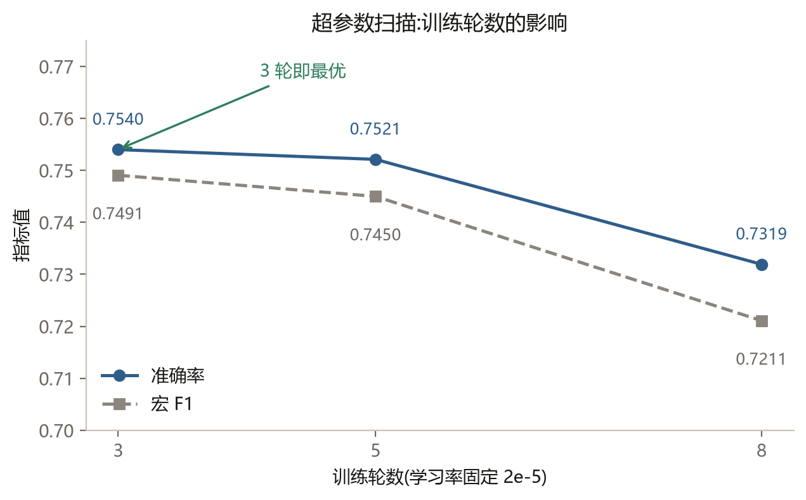

**表 6-6 超参扫描**

| 配置 | epoch | 学习率 | 准确率 | 宏 F1 |
|---|---|---|---|---|
| **ep3_lr2e-05（基线）** | 3 | 2e-5 | **0.7540** | **0.7491** |
| ep5_lr2e-05 | 5 | 2e-5 | 0.7521 | 0.7450 |
| ep8_lr2e-05 | 8 | 2e-5 | 0.7319 | 0.7211 |
| ep5_lr3e-05 | 5 | 3e-5 | 0.7460 | 0.7437 |
| ep5_lr1e-05 | 5 | 1e-5 | 0.7366 | 0.7299 |

基线配置 ep3/lr2e-5 的 0.7540 已是扫描范围内最优。ep5 降到 0.7521，ep8 降到 0.7319——此时训练 loss 已降到 0.0518，测试准确率反而下降，是明确的过拟合。降低学习率到 $1\times10^{-5}$ 同样变差（0.7366），升高到 $3\times10^{-5}$ 也变差（0.7460）。

这一节堵死"你没调参"的质疑：基线不是欠训练的结果，换更好的超参数拿不到增益。

### 6.7 决策阈值校准

argmax 决策隐含一个假设：各类先验相等、错分代价相同。本文数据中性占 42%，这一假设并不成立。一个自然的改进是给各类乘上不同权重再做 argmax。

**表 6-7 决策阈值校准**

| 权重来源 | 中性权重 | 是否用测试集 | 准确率 | 宏 F1 |
|---|---|---|---|---|
| 逆训练集先验 | 0.7063 | 否 | — | — |
| 测试集 oracle 搜索 | 0.5000 | **是（选择偏差）** | 0.7700 | 0.7685 |
| 5 折交叉验证平均 | — | 否 | 增益 **+0.0012**（方向不稳） | — |

表 6-7 给出三种权重来源。按逆训练集先验取权重，中性权重为 0.7063，这是不看测试集的合法做法。直接在测试集上搜索最优权重，可得到 0.7700 的准确率与 0.7685 的宏 F1，但这是选择偏差——权重是在评测数据上挑出来的，不能算作模型的真实能力。改用 5 折交叉验证，平均增益仅 +0.0012，且各折方向不一致，McNemar 检验 $p=0.3634$，不显著。

因此本文不把阈值校准算作改进。这一节本身也是结论的一部分：一个方法在单次划分上数字好看，经不起交叉验证，就不能写进成绩表。

### 6.8 多种子集成

多种子集成是六类改进中唯一一个部分显著的，需要写得最小心。

**表 6-8 多种子集成**

| 种子 | 准确率 | 宏 F1 |
|---|---|---|
| 42（基线） | 0.7540 | 0.7491 |
| 1 | 0.7390 | 0.7316 |
| 2 | 0.7502 | 0.7469 |
| 3 | 0.7582 | 0.7552 |
| 4 | 0.7488 | 0.7465 |
| **5 种子概率平均** | **0.7653** | **0.7619** |
| 种子间极差 | 0.0192 | 0.0236 |

首先要交代一个前提：单次实验本身就带不确定性。用 5 个不同随机种子（42、1、2、3、4）分别训练，准确率跨度 0.7390 至 0.7582，极差 0.0192；宏 F1 跨度 0.7316 至 0.7552，极差 0.0236。也就是说，即使不做任何改进，换个种子就能有约 ±1 个百分点的波动。任何小于这个幅度的"提升"都需要统计检验支撑。

表 6-8 给出集成结果。5 个种子的概率平均取得 0.7653 的准确率与 0.7619 的宏 F1，相对 seed42 基线提升 1.13 与 1.28 个百分点。

**表 6-9 显著性检验汇总**

| 对比 | 检验 | 统计量 | p 值 | 结论 |
|---|---|---|---|---|
| 集成 vs seed42 | McNemar | b=86, c=62 | 0.0583 | 不显著 |
| 集成 vs seed42 | Bootstrap 准确率 | Δ=+0.0111，95%CI [−0.0005, +0.0221] | — | 跨 0 |
| 集成 vs seed42 | Bootstrap 宏 F1 | Δ=+0.0128，95%CI [+0.0010, +0.0243] | — | 不含 0 |
| 4 种子集成（不含 42） vs seed42 | McNemar | b=114, c=89 | 0.0918 | 不显著 |
| 4class 辅助头 vs 极性专用 | McNemar | b=71, c=62 | 0.4880 | 不显著 |
| mtl 辅助头 vs 极性专用 | McNemar | b=70, c=77 | 0.6208 | 不显著 |
| 元分类器 vs 基线 | McNemar | b=95, c=83 | 0.4097 | 不显著 |
| 无泄漏对照 vs 同子集基线 | McNemar | b=53, c=40 | 0.2132 | 不显著 |
| 阈值校准（5 折 CV） vs 基线 | McNemar | — | 0.3634 | 不显著 |

显著性检验（表 6-9）给出两个不一致的结论。McNemar 检验比较集成与 seed42 的逐样本对错，$b=86$、$c=62$，$p=0.0583$，未达 0.05 显著水平。Bootstrap 重采样 2000 轮给出：准确率差值 +0.0111，95% 置信区间 $[-0.0005, +0.0221]$，跨 0；宏 F1 差值 +0.0128，95% 置信区间 $[+0.0010, +0.0243]$，不含 0。

作为补充对照，用不含 42 的另外 4 个种子集成，准确率 0.7657、提升 1.17 个百分点，McNemar $p=0.0918$，同样不显著。

两个检验结论不一致时该怎么处理？本文的做法是：两个结果都报告，把集成定位为"方向一致但证据强度不足"，不写进成绩表。硬说"显著"会忽略 McNemar 的结果；硬说"无效"会忽略宏 F1 的置信区间。两种做法都比如实报告两个结果更弱。

### 6.9 本章小结

本章报告了六类改进尝试：级联与分层路由、多任务与四分类重构、概率堆叠、超参扫描、阈值校准、多种子集成。除集成在宏 F1 的 bootstrap 区间上边缘显著外，其余均未取得统计显著且可复现的提升。这些负结论与第 5 章的正向论证互为补充：如果瓶颈在模型容量，增加复杂度或后处理力度应当有效；实际无效，说明瓶颈在标签体系。在现有标注规范下，继续提高模型复杂度的边际收益有限。

---

## 第 7 章 系统设计与实现

### 7.1 需求分析

系统的目标是把第 4 章的模型变成可演示、可复现的工具，而不是停留在实验脚本。功能需求有四块：数据采集（股票行情与相关新闻）、情感标注（对采集到的文本批量判定情感）、可视化看板（展示行情、情感分布、来源构成）、关联分析（检验情感指标与未来收益的关系）。

非功能需求有四项。一是容错：任一数据源不可用时系统应继续工作，不能整页报错。二是降级：情感模型缺失时应退到可用模型或纯展示模式。三是可校验：所有接口参数必须有范围约束，越界请求返回明确错误而非静默截断。四是可测试：核心逻辑应能脱离网络与浏览器单测。

### 7.2 总体架构

系统采用三层架构（图 7-1）。采集层负责从外部数据源获取行情与新闻，并做字段归一化；服务层基于 FastAPI 提供 REST 接口，用 SQLAlchemy 管理数据访问，用独立的推理模块加载情感模型；展示层为 Vue 3 单页应用，用 ECharts 绘图。

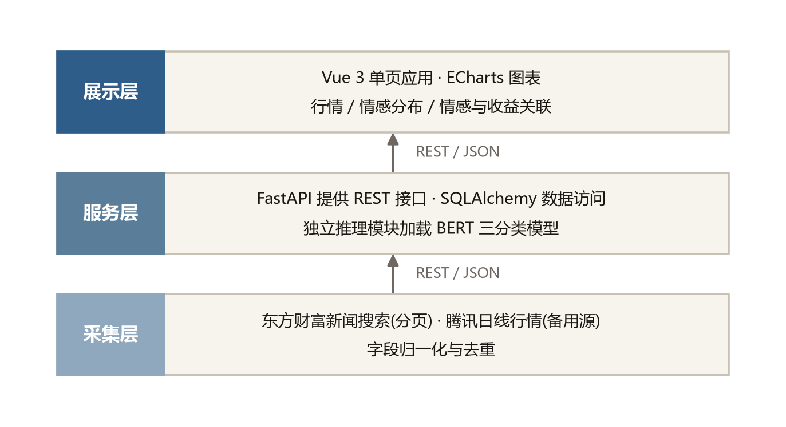

关键技术选型及理由如下。Web 框架选 FastAPI 而非 Flask，因为前者基于类型注解自动完成参数校验并生成 OpenAPI 文档，本文的 10 个接口中多数带数值范围约束，用 FastAPI 只需声明一次。ORM 选 SQLAlchemy 而非裸 SQL，因为三张表的字段与约束需要在代码中集中定义，且需要支持 SQLite 与 MySQL 两种后端切换。前端选 Vue 3 的组合式 API，因为看板的数据加载是并行的多个请求，组合式写法比选项式更清晰。图表库选 ECharts 而非 Chart.js，因为前者对 K 线图、双轴、散点拟合等金融图表有原生支持。

系统对外提供 10 个接口（表 7-1），覆盖股票列表、日线行情、新闻列表、概览、情感统计、关联分析、采集触发、模型信息与批量判定。

**表 7-1 系统接口清单**

| 方法 | 路径 | 说明 |
|---|---|---|
| GET | `/api/health` | 健康检查 |
| GET | `/api/stocks` | 股票列表（含数据量） |
| GET | `/api/stocks/{code}/klines?limit=120` | 日线行情（limit 上限 20000） |
| GET | `/api/stocks/{code}/news?limit=50` | 新闻列表 |
| GET | `/api/stocks/{code}/overview` | 概览（最新价、来源分布） |
| GET | `/api/stocks/{code}/sentiment?limit=500` | 情绪统计与按日聚合 |
| GET | `/api/stocks/{code}/returns?lag=1&min_news=1` | 情感指数与未来收益的关联分析 |
| POST | `/api/stocks/{code}/sync?news_pages=1` | 触发采集（行情 + 新闻 + 情感回填） |
| GET | `/api/sentiment/info` | 情感模型可用性与指标 |
| POST | `/api/sentiment/analyze` | 对任意文本批量判情感（最多 200 条） |

### 7.3 数据库设计

数据库有三张表（表 7-2，图 7-2 为 ER 图）。`Stock` 以股票代码为主键，记录名称与市场。`Kline` 存日线行情，字段包括开高低收、成交量、成交额、振幅与涨跌幅。`News` 存新闻标题，字段包括标题、链接、来源、发布时间与情感标注结果。

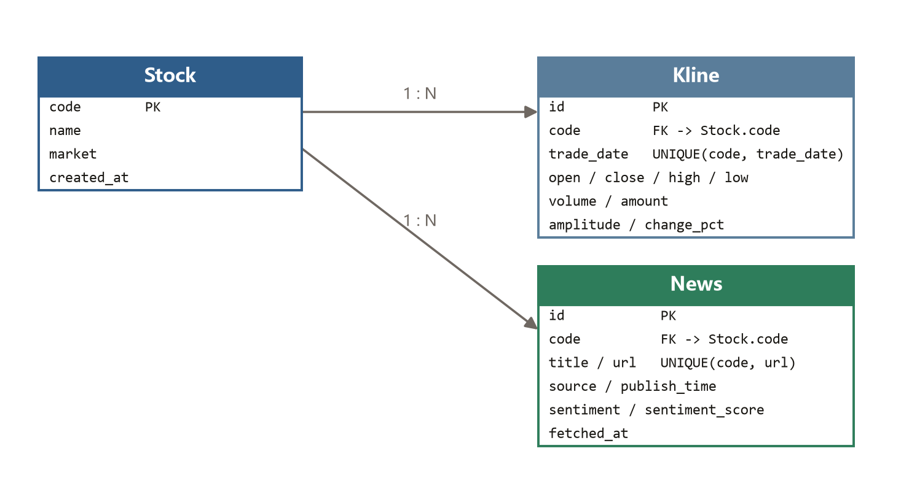

**表 7-2 数据库表结构**

| 表 | 主要字段 | 约束 |
|---|---|---|
| `Stock` | `code`(PK)、`name`、`market`、`created_at` | 主键 `code` |
| `Kline` | `id`、`code`(FK)、`trade_date`、`open`、`close`、`high`、`low`、`volume`、`amount`、`amplitude`、`change_pct` | `UNIQUE(code, trade_date)`；索引 `(code, trade_date)` |
| `News` | `id`、`code`(FK)、`title`、`url`、`source`、`publish_time`、`sentiment`、`sentiment_score`、`fetched_at` | `UNIQUE(code, url)`；索引 `(code, publish_time)` |

两个约束是设计上的关键决策。`Kline` 在 `(code, trade_date)` 上建唯一约束，`News` 在 `(code, url)` 上建唯一约束。这两条约束使得重复采集天然幂等——同一交易日的行情、同一链接的新闻只会入库一次，采集任务可以反复运行而不产生重复数据。这一设计在工程上的价值很高：数据源不稳定时，运维人员可以放心地反复重试而不必先清理数据。

数据库后端可切换。默认使用 SQLite（零配置，适合单机演示），修改一行配置即可切到 MySQL。本章报告的数据规模来自 MySQL 后端。

### 7.4 数据采集模块

数据采集模块采用主备双源设计，这是本文在实现过程中被迫做出的一个工程决策。

主源为东方财富的 `push2his` 接口。2026 年 10 月 17 日起，该接口的全部编号主机（`push2his`、`1.push2his`、`7.push2his`、`23.push2his`、`48.push2his`、`push2delay`）均在 0.2 至 0.3 秒内返回 `RemoteDisconnected`。这个响应时间说明问题不在限流——限流通常伴随延迟上升，且冷却后应恢复。本文尝试了更换 User-Agent、添加 Referer、冷却 30 至 90 秒后重试，均无改善；同一时刻东方财富的实时报价接口与新闻搜索接口工作正常。因此判断为该域名的日线接口对本机网络整体不可达。

若不处理，增量更新将完全失效。本文引入腾讯的 `web.ifzq.gtimg.cn` 作为备用源，在行情获取函数中捕获主源异常后自动回退，上层调用无需感知。

备用源的接入需要验证口径一致性，否则两源数据混存会导致指标错误。本文取腾讯返回的 640 条日线（2024-02-26 至 2026-10-16），与库内已有的东财数据逐日比对，结果在 640 个重叠交易日上开盘价、收盘价、成交量完全一致，确认两者同为前复权口径，可以安全混存。

腾讯接口只返回 6 个字段（日期、开、收、高、低、量），缺少振幅与成交额。本文按东财口径补算：振幅取 $(\text{最高价}-\text{最低价})/\text{前收盘价}\times100$，用 10 月 15 日与 16 日的数据验证，结果分别为 2.78 与 2.15，与东财一致；成交额取 $\text{成交量}\times100\times\text{收盘价}$ 近似，与东财真值相差约 0.8%，该字段仅用于展示，精度可接受。

新闻采集采用关键词检索加分页。关键词取股票名称，通过翻页深度参数控制采集量。实测第 40 页仍能返回数据，可回溯约 3 个月。所有结果按链接去重，单页失败时中断而非抛出异常，避免因一页失败导致整次采集作废。

### 7.5 情感推理模块

情感推理模块的设计目标是"模型可换、缺失可用"。

模型按目录约定加载：`models/sentiment-{kind}-{task}`，其中 `kind` 为 `bert` 或 `tfidf`，`task` 为 `3class`、`polarity` 或 `neutral`。启动时按优先级探测，BERT 可用则用 BERT，否则退到 TF-IDF，两者都不可用则进入纯展示模式（仅采集与可视化，不做标注）。

推理采用批量方式，批大小为 64。标注函数只处理情感字段为空字符串的行，已有标注的记录跳过。这使得标注任务可以反复调用而不重复计算，也使得中断后可以续跑。

针对单机显存被其他程序占用的实际情况，本文加了 CUDA 内存不足的自动回退。推理函数捕获 `RuntimeError`，仅当异常信息包含 `out of memory` 且当前设备不是 CPU 时，清空显存缓存、把模型搬到 CPU、重算当前批。其他 `RuntimeError` 照常抛出，避免把真实故障掩盖成"自动降级"。这一设计在演示场景下很实用：即使显卡被其他程序占用，系统仍能完成标注，只是速度变慢。

### 7.6 情感—收益关联分析

关联分析模块检验一个具体问题：当日情感指标能否预测次日收益。

情感指标采用 Antweiler 与 Frank[19] 的 bullishness 定义：$\text{polarity} = (\text{正面条数} - \text{负面条数}) / \text{当日新闻总数}$，取值区间为 $[-1, 1]$。中性条目不参与分子，但计入分母，因此 polarity 同时反映了情感方向与态度强度。

时间对齐规则需要仔细设计。本文采用的规则是：先把每条新闻归到"发布日之前（含当天）最后一个交易日"，再加 $lag$ 个交易日取收益。这个规则有一个容易写错的地方：若按"发布日之后第一个交易日"归属，周六发布的新闻会被推到下一个周一，再加一天滞后就变成周二，多跳了一个交易日。本文初版实现正是错在这里，用周末数据测试时才发现。

**表 7-6 情感指数与次日收益的关联分析**

| 范围 | 样本数 | Pearson | p 值 | Spearman | 方向命中率 |
|---|---|---|---|---|---|
| 全部 13 只股票 | 744 | −0.0019 | 0.9579 | 0.0090 | 0.4778（n=496） |
| 600519 贵州茅台 | 43 | 0.1103 | 0.4775 | 0.1144 | 0.5161（n=31） |
| 600276 恒瑞医药 | 48 | 0.2829 | **0.0455** | 0.2014 | 0.4231（n=26） |
| 601899 紫金矿业 | 61 | −0.2370 | 0.0610 | −0.2042 | 0.3514（n=37） |

表 7-6 给出 13 只股票的全样本结果。共 744 个股票-日样本，Pearson 相关系数 −0.0019（$p=0.9579$），Spearman 相关系数 0.0090。按 polarity 分三组看次日收益：低组 −0.097%、中组 0.026%、高组 −0.062%，无单调关系。方向命中率 0.4778（$n=496$），低于 0.5。图 7-4 是情感指数与次日收益的散点图，拟合线接近水平。

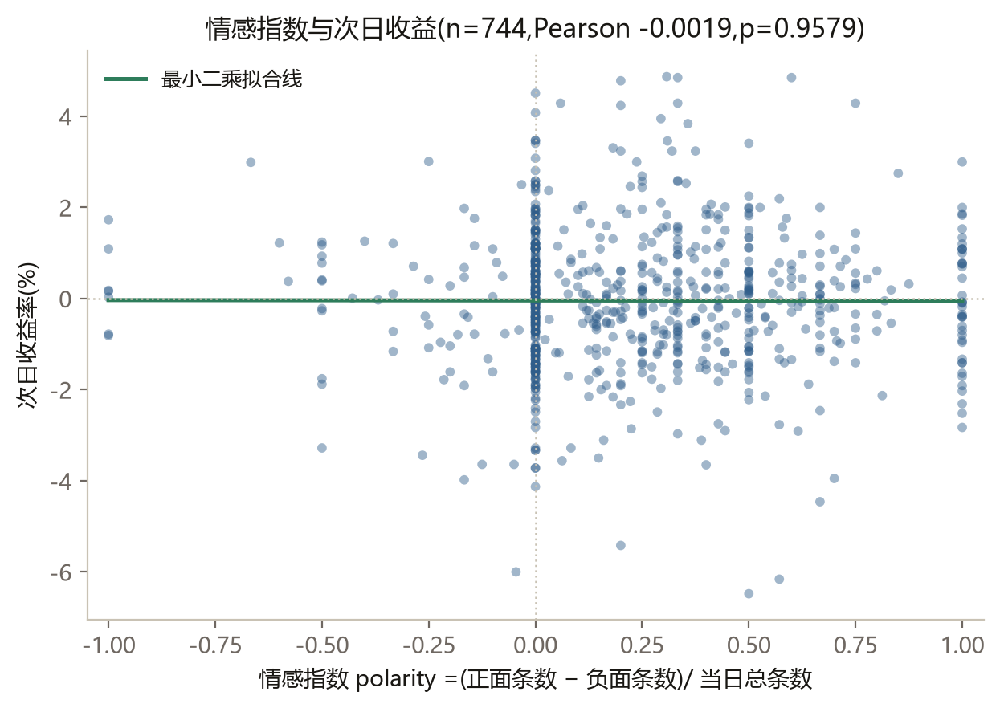

单股层面，13 次检验中只有 600276（恒瑞医药）达到 $p<0.05$（Pearson 0.2829，$p=0.0455$）。但 13 次独立检验在 0.05 水平下预期会产生约 0.65 个假阳性，出现 1 个显著结果属于预期之内，不构成证据。

这里需要说明相关系数对样本量的敏感性。本文在扩样本过程中观察到，小样本下的相关系数估计波动很大，随着样本量增加逐渐收敛到 0 附近。这提示：在小样本上得到的相关系数不宜直接下结论。本文因此只报告全样本结果，并对单股结果明确标注为不构成证据。

结论必须限定范围：在本数据、本时间窗口（2026 年 6 月至 10 月）、线性相关的前提下，情感指标对次日收益没有可检出的预测能力。这不等于"情感分析对股价无效"——非线性关系、更长的时间窗口、事件研究法都不在本文检验范围内（见第 8 章）。

### 7.7 前端实现

前端为单页应用，按功能划分为 7 个组件：`StockBar`（股票切换）、`OverviewCards`（概览指标）、`EChart`（图表容器）、`SentimentPanel`（情感分布与趋势）、`SourceBreakdown`（来源构成）、`ReturnsPanel`（情感与收益关联）、`NewsList`（新闻列表）。

图表配置抽成 `utils/chart.js` 中的纯函数（K 线、情感饼图、情感趋势、收益散点），输入数据、输出 ECharts 配置对象。这样图表逻辑可以脱离浏览器做单元测试，不必启动真实渲染环境。

关联分析面板在样本量低于 30 时显示提示，说明此时相关系数波动很大。这一设计来自 7.6 节的经验：小样本相关系数不可靠，界面应当主动告知用户，而不是给出一个看起来精确的数字。

### 7.8 系统测试

系统共 575 项自动化测试，其中后端 493 项（pytest）、前端 82 项（Vitest + @vue/test-utils），另有技能安装检查 133 项（表 7-5）。

**表 7-5 系统测试覆盖**

| 层 | 测试数 | 框架 |
|---|---|---|
| 后端 | 493 | pytest |
| 前端 | 82 | Vitest + @vue/test-utils |
| 合计 | **575** | |

后端测试全部离线可跑：用临时 SQLite 建库，用打桩函数替换情感模型与网络请求，因此不依赖显卡与外网。前端测试运行在 jsdom 环境中，用 `@vue/test-utils` 挂载组件并断言渲染结果。

举三个有代表性的用例说明测试的针对性。"新闻分页去重"验证多页采集时同一链接不会重复入库，对应 7.4 节的分页逻辑。"主源失败自动回退"用打桩函数让主源抛异常，断言第二次调用走了腾讯地址，对应 7.4 节的备用源设计。"情感模型缺失时降级"删除模型目录后断言系统仍能启动并返回可用性信息，对应 7.5 节的降级链。

### 7.9 系统运行数据

系统当前覆盖 13 只股票，累计采集日线行情 72235 条、新闻 6420 条，全部新闻已完成情感标注。

**表 7-3 系统数据规模（2026-10-17 实测）**

| 项目 | 数量 |
|---|---|
| 股票 | 13 只 |
| 日线行情 | 72235 条 |
| 新闻 | 6420 条（全部已完成情感标注） |
| 新闻覆盖日期 | 113 天（2026-06-09 至 2026-10-17） |
| 单只股票新闻量 | 488–498 条 |

**表 7-4 系统新闻情感分布**

| 情感 | 条数 | 占比 |
|---|---|---|
| 正面 | 2062 | 32.12% |
| 负面 | 426 | 6.64% |
| 中性 | 3932 | 61.25% |

情感分布见表 7-4：正面 2062 条（32.12%）、负面 426 条（6.64%）、中性 3932 条（61.25%）。需要特别说明的是，这个分布与训练数据集（中性 42.05%）差异明显。原因是训练数据为股吧标题，而系统在线采集的是财经新闻标题，两者语体不同：股吧标题带有更多明确的情绪表达，新闻标题则以客观陈述为主。这一差异意味着不能假定模型在新闻标题上的表现与在测试集上一致，本文未对此做独立评测，第 8 章将其列为不足。

### 7.10 本章小结

本章描述了一个三层架构的原型系统，实现数据采集、情感标注、可视化看板与关联分析四项功能。采集层做了主备双源与口径一致性验证，推理层做了模型降级链与显存不足回退，分析层给出了情感指标与次日收益的关联检验。系统当前覆盖 13 只股票、72235 条日线、6420 条新闻，全部新闻已完成情感标注，并通过 575 项自动化测试。

---

## 第 8 章 总结与展望

### 8.1 工作总结

本文围绕财经股吧短文本的三分类情感分析，完成了四项工作。

第一，完成了数据质量核查。在 10646 条人工标注数据上，确认训练集内部无完全重复、训练集与测试集无交集、近重复组中标签冲突仅 1 组 2 条、超过输入长度上限的样本仅 2 条（0.02%）。这些核查排除了"后续结论由脏数据造成"这一替代解释。

第二，完成了双路线三任务对比。BERT 微调在三分类任务上取得 0.7540 的准确率与 0.7491 的宏 F1，较 TF-IDF 加逻辑回归的 0.6296 与 0.6204 分别高出 12.44 与 12.87 个百分点；在极性二分类与"中性对情感"二分类上同样领先。代价是 10 至 42 倍的训练时间。

第三，定位了性能瓶颈。524 个测试错误中 385 个（73.47%）牵涉中性边界，是极性互错（139 个，26.53%）的 2.8 倍。结合问句统计、句式切分与剔除重训三条证据，判断中性标签把"没有态度"与"只是在提问"两类样本混为一类，边界因此不清晰。六类改进实验均未取得统计显著且可复现的提升，从反面支持这一判断。

第四，实现了一套可用系统。系统覆盖 13 只股票、72235 条日线与 6420 条新闻，提供采集、标注、可视化与关联分析四项功能，通过 575 项自动化测试。

### 8.2 不足与展望

本文的不足有四点，逐条说明。

第一，训练数据与系统实际处理的文本存在语体差异。模型在股吧标题数据集上训练与评测，而系统在线采集的是财经新闻标题。两者的情感分布明显不同：训练集中性占 42.05%，系统采集的新闻中性占 61.25%。本文未对系统在新闻标题上的标注能力做独立评测，因此不能声称模型能力可直接迁移。后续应当接入股吧数据源，或构建跨语体的评测集，做迁移能力的定量分析。

第二，中性标签的复合性只做了统计论证，未做重新标注验证。本文用四条统计证据支持"复合标签"假设，但没有组织标注者按新规范（区分陈述式中性与提问式中性）重新标注，因此无法给出"拆分后标注一致性提高多少"的直接证据。后续应当设计标注实验，用 Cohen 的 Kappa 系数[31]比较拆分前后的编码者一致性。

第三，情感与收益的关联分析未检出显著关系。这一结论限定在本文的数据范围、时间窗口与线性相关假设下。后续可以引入非线性模型、拉长观察窗口，或改用事件研究法，检验情感冲击在事件窗口内的短期反应。

第四，系统为单机部署，未做并发压力测试。当前的数据规模在单机 SQLite 或 MySQL 上响应良好，但若扩展到全市场数千只股票，需要重新评估索引设计与缓存策略。

---

## 参考文献

[1] 赵妍妍, 秦兵, 刘挺. 文本情感分析[J]. 软件学报, 2010, 21(8): 1834-1848. https://www.cnki.com.cn/Article/CJFDTOTAL-RJXB201008009.htm.

[2] 陆文星, 王燕飞. 中文文本情感分析研究综述[J]. 计算机应用研究, 2012, 29(6): 2014-2017. https://opaj.napstic.cn/periodicalArticle/0120121000952029.

[3] SPARCK JONES K. A statistical interpretation of term specificity and its application in retrieval[J]. Journal of Documentation, 1972, 28(1): 11-21. DOI: 10.1108/eb026526.

[4] SALTON G, BUCKLEY C. Term-weighting approaches in automatic text retrieval[J]. Information Processing & Management, 1988, 24(5): 513-523. DOI: 10.1016/0306-4573(88)90021-0.

[5] CORTES C, VAPNIK V. Support-vector networks[J]. Machine Learning, 1995, 20(3): 273-297. DOI: 10.1007/BF00994018.

[6] JOACHIMS T. Text categorization with support vector machines: learning with many relevant features[C]//Machine Learning: ECML-98, Lecture Notes in Computer Science. 1998: 137-142. DOI: 10.1007/BFb0026683.

[7] DEVLIN J, CHANG M W, LEE K, et al. BERT: pre-training of deep bidirectional transformers for language understanding[C]//Proceedings of NAACL-HLT 2019. Minneapolis, Minnesota, 2019: 4171-4186. DOI: 10.18653/v1/N19-1423.

[8] CUI Y, CHE W, LIU T, et al. Pre-training with whole word masking for Chinese BERT[J]. IEEE/ACM Transactions on Audio, Speech, and Language Processing, 2021, 29: 3504-3514. DOI: 10.1109/TASLP.2021.3124365.

[9] SAIF H, HE Y, FERNANDEZ M, et al. Contextual semantics for sentiment analysis of Twitter[J]. Information Processing & Management, 2016, 52(1): 5-19. DOI: 10.1016/j.ipm.2015.01.005.

[10] CHEN C C, HUANG H H, CHEN H H. NLG301 at SemEval-2017 Task 5: fine-grained sentiment analysis on financial microblogs and news[C]//Proceedings of the 11th International Workshop on Semantic Evaluation (SemEval-2017). Vancouver, Canada, 2017: 847-851. DOI: 10.18653/v1/S17-2144.

[11] LOUGHRAN T, MCDONALD B. When is a liability not a liability? Textual analysis, dictionaries, and 10-Ks[J]. The Journal of Finance, 2011, 66(1): 35-65. DOI: 10.1111/j.1540-6261.2010.01625.x.

[12] MALO P, SINHA A, KORHONEN P, et al. Good debt or bad debt: detecting semantic orientations in economic texts[J]. Journal of the Association for Information Science and Technology, 2014, 65(4): 782-796. DOI: 10.1002/asi.23062.

[13] ARACI D. FinBERT: financial sentiment analysis with pre-trained language models[EB/OL]. arXiv:1908.10063, 2019. DOI: 10.48550/arXiv.1908.10063.

[14] YANG Y, UY M C S, HUANG A. FinBERT: a pretrained language model for financial communications[EB/OL]. arXiv:2006.08097, 2020. DOI: 10.48550/arXiv.2006.08097.

[15] 祝清麟, 梁斌, 徐睿峰, 等. 结合金融领域情感词典和注意力机制的细粒度情感分析[J]. 中文信息学报, 2022, 36(8): 109-117. https://www.sinomed.ac.cn/article.do?ui=2022453144.

[16] 李大宇, 李旸, 王素格. 大规模中文金融情感分析数据集自动构建[J]. 山西大学学报(自然科学版), 2024, 47(4): 776-785. DOI: 10.13451/j.sxu.ns.2024111.

[17] ZHANG X, YANG Q. FinMoE: a MoE-based large Chinese financial language model[C]//Proceedings of the Joint Workshop of FinNLP/FNP/LLMFinLegal. Abu Dhabi, UAE, 2025: 48-53. https://aclanthology.org/2025.finnlp-1.4/.

[18] ZHAO S, QIAO L, LUO K, et al. SNFinLLM: systematic and nuanced financial domain adaptation of Chinese large language models[EB/OL]. arXiv:2408.02302, 2024. DOI: 10.48550/arXiv.2408.02302.

[19] ANTWEILER W, FRANK M Z. Is all that talk just noise? The information content of internet stock message boards[J]. The Journal of Finance, 2004, 59(3): 1259-1294. DOI: 10.1111/j.1540-6261.2004.00662.x.

[20] 段江娇, 刘红忠, 曾剑平. 中国股票网络论坛的信息含量分析[J]. 金融研究, 2017, 448(10): 178-192. DOI: 10.12094/1002-7246(2017)10-0178-15.

[21] 王娜, 贺毅岳, 刘磊. 股市投资者情绪指数构建及其有效性研究——基于东方财富股吧帖文的情感分析[J]. 价格理论与实践, 2022(11): 146-151. https://www.cnki.com.cn/Article/CJFDTOTAL-JGLS202211030.htm.

[22] 尹海员, 杨庆松. 基于Bi-LSTM模型挖掘的股吧投资者情绪对股价泡沫的影响[J]. 管理学报, 2022, 19(12): 1874-1885. https://www.cnki.com.cn/Article/CJFDTOTAL-GLXB202212016.htm.

[23] 尹海员, 南早红. 基于深度学习的投资者情绪挖掘及其对股价崩盘风险的影响[J]. 中央财经大学学报, 2024(3): 36-56. https://www.cnki.com.cn/Article/CJFDTOTAL-ZYCY202403004.htm.

[24] LUAN Y, ZHANG H, ZHANG C, et al. Stock price prediction with sentiment analysis for Chinese market[C]//Proceedings of the Joint Workshop of the 7th FinNLP, 5th KDFUS, 4th ECONLP. Torino, Italia, 2024: 167-177. https://aclanthology.org/2024.finnlp-1.16/.

[25] 李梦, 黄政祺. 基于Bert股吧舆情分析的特征融合股价走势预测研究[J]. 重庆工商大学学报(自然科学版), 2023, 40(4): 77-86. DOI: 10.16055/j.issn.1672-058X.2023.0004.011.

[26] SOKOLOVA M, LAPALME G. A systematic analysis of performance measures for classification tasks[J]. Information Processing & Management, 2009, 45(4): 427-437. DOI: 10.1016/j.ipm.2009.03.002.

[27] OPITZ J, BURST S. Macro F1 and macro F1[EB/OL]. arXiv:1911.03347, 2019. DOI: 10.48550/arXiv.1911.03347.

[28] HE H, GARCIA E A. Learning from imbalanced data[J]. IEEE Transactions on Knowledge and Data Engineering, 2009, 21(9): 1263-1284. DOI: 10.1109/TKDE.2008.239.

[29] BUDA M, MAKI A, MAZUROWSKI M A. A systematic study of the class imbalance problem in convolutional neural networks[J]. Neural Networks, 2018, 106: 249-259. DOI: 10.1016/j.neunet.2018.07.011.

[30] CHAWLA N V, BOWYER K W, HALL L O, et al. SMOTE: synthetic minority over-sampling technique[J]. Journal of Artificial Intelligence Research, 2002, 16: 321-357. DOI: 10.1613/jair.953.

[31] COHEN J. A coefficient of agreement for nominal scales[J]. Educational and Psychological Measurement, 1960, 20(1): 37-46. DOI: 10.1177/001316446002000104.

[32] LANDIS J R, KOCH G G. The measurement of observer agreement for categorical data[J]. Biometrics, 1977, 33(1): 159-174. DOI: 10.2307/2529310.

[33] ARTSTEIN R, POESIO M. Inter-coder agreement for computational linguistics[J]. Computational Linguistics, 2008, 34(4): 555-596. DOI: 10.1162/coli.07-034-R2.

[34] LOU J. Stock market sentiment classification and backtesting via fine-tuned BERT[EB/OL]. arXiv:2309.11979, 2023. DOI: 10.48550/arXiv.2309.11979.

[35] PEDREGOSA F, VAROQUAUX G, GRAMFORT A, et al. Scikit-learn: machine learning in Python[J]. Journal of Machine Learning Research, 2011, 12(85): 2825-2830. https://www.jmlr.org/papers/v12/pedregosa11a.html.

[36] WOLF T, DEBUT L, SANH V, et al. Transformers: state-of-the-art natural language processing[C]//Proceedings of the 2020 Conference on Empirical Methods in Natural Language Processing: System Demonstrations. 2020: 38-45. DOI: 10.18653/v1/2020.emnlp-demos.6.

[37] DEVLIN J, CHANG M W, LEE K, et al. BERT: pre-training of deep bidirectional transformers for language understanding[EB/OL]. arXiv:1810.04805, 2018. DOI: 10.48550/arXiv.1810.04805.

---

## 致谢

（本节待作者本人撰写。建议致谢对象：指导教师、参与数据标注的同学、提供计算资源的实验室；行文用第一人称，避免套话堆砌。）

---

## 附录

### 附录 A 训练超参数

| 参数 | 取值 |
|---|---|
| 预训练权重 | `bert-base-chinese` |
| 最大输入长度 | 64 |
| 批大小 | 32 |
| 训练轮数 | 3 |
| 学习率 | 2e-5 |
| 随机种子 | 42 |
| 优化器 | AdamW（transformers 默认） |

### 附录 B 实验数据文件索引

| 文件 | 内容 |
|---|---|
| `data/experiments/REPORT.md` | 三任务对比、混淆矩阵、分类明细 |
| `data/experiments/NEUTRAL_ANALYSIS.md` | 中性瓶颈四条证据链 |
| `data/experiments/ABLATION.md` | 六类负结论汇总 |
| `data/experiments/*.json` | 各次实验原始数值 |
| `data/raw/eastmoney_train.csv` | 训练集（列名 `title` / `label`） |
| `data/raw/eastmoney_test.csv` | 测试集 |

### 附录 C 图表清单与出图说明

全文共 14 张图。其中 13 张由脚本 `tools/make_figures.py` 统一生成，输出到 `论文/figures/`，可用一条命令重建：

```
.python\python.exe tools\make_figures.py
```

脚本从 `data/raw/` 与 `data/experiments/` 直接读取原始数值，不手抄数字，因此图中数字与正文表格始终一致。图 7-3 为系统运行界面截图，需从运行中的系统人工截取，脚本不生成。

| 编号 | 名称 | 数据来源 | 文件 |
|---|---|---|---|
| 图 1-1 | 技术路线图 | — | `figures/fig-1-1.png` |
| 图 2-1 | BERT 微调流程 | — | `figures/fig-2-1.png` |
| 图 3-1 | 训练集标签分布 | 表 3-1 | `figures/fig-3-1.png` |
| 图 3-2 | 标题词元长度分布 | `eastmoney_train.csv` | `figures/fig-3-2.png` |
| 图 4-1 | 三任务指标对比 | 表 4-1 | `figures/fig-4-1.png` |
| 图 4-2 | 混淆矩阵热力图 | 表 4-4 | `figures/fig-4-2.png` |
| 图 5-1 | 三类问句占比对比 | 表 3-4 | `figures/fig-5-1.png` |
| 图 5-2 | 错误流向 | 表 5-2 | `figures/fig-5-2.png` |
| 图 5-3 | 问句组与陈述句组对比 | 表 5-4 | `figures/fig-5-3.png` |
| 图 6-1 | 超参扫描曲线 | 表 6-6 | `figures/fig-6-1.png` |
| 图 7-1 | 系统三层架构 | — | `figures/fig-7-1.png` |
| 图 7-2 | 数据库 ER 图 | 表 7-2 | `figures/fig-7-2.png` |
| 图 7-3 | 系统界面截图 | 实际运行 | 待人工截取 |
| 图 7-4 | 情感指数与次日收益散点 | 表 7-6 | `figures/fig-7-4.png` |

出图需注意两点。第一，中文字体须显式注册 `C:/Windows/Fonts/msyh.ttc`，并设 `axes.unicode_minus=False`，否则负号会显示为方块。第二，沙箱环境下 `MPLCONFIGDIR` 须指向工作区内可写目录，脚本已内置该处理。画图纪律：图必须有编号与标题，正文要有一句"如图 X-Y 所示"引到；图中数字须与表一致；截图前先隐藏书签栏与标签页，避免泄露个人信息。
